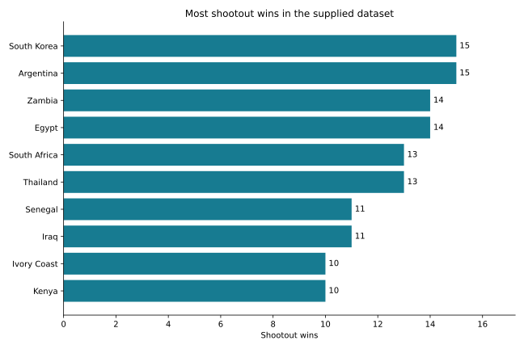

# Football Shootout Analysis

A Python workflow for summarizing international football penalty shootouts at match level. Explore team appearances, wins, losses, win rates, yearly counts and outcomes when the first-shooting team is known.

## Features

- Validates dates, participants, winners and optional first-shooter labels.
- Rejects duplicate match keys, including reversed home/away team order.
- Retains matches with missing first-shooter information in team statistics.
- Calculates team win rates using each team's shootout appearances as the denominator.
- Exports CSV summaries, a JSON audit and an SVG chart of the ten teams with the most wins.
- Includes a synthetic example and six unit tests.

## Results

The supplied snapshot contains **645 shootouts**, **222 distinct team labels** and **1,290 team appearances**, spanning **22 August 1967 to 8 September 2024**.

| Team | Appearances | Wins | Win rate |
| --- | ---: | ---: | ---: |
| South Korea | 25 | 15 | 60.00% |
| Argentina | 23 | 15 | 65.22% |
| Zambia | 25 | 14 | 56.00% |
| Egypt | 24 | 14 | 58.33% |
| South Africa | 28 | 13 | 46.43% |



First-shooter information is available for **230 matches** and missing for **415**. The first-shooting team won **124 of the 230 known cases (53.91%)**. This describes the observed subset; it does not establish a causal first-shooter advantage.

## Run

Requires Python 3.10 or later.

```bash
python -m pip install -r requirements.txt
python analyze.py examples/demo.csv --output demo_results
python -m unittest -v
```

The example contains fictional teams. To analyze your own file:

```bash
python analyze.py data/shootouts.csv --output results
```

Required columns: `date` (YYYY-MM-DD), `home_team`, `away_team`, `winner`. Optional: `first_shooter`. Each row represents one match; the winner and any known first shooter must be one of its two teams. The full match-level input is not bundled.

## Outputs and interpretation

- [Team summaries](results/team_summary.csv): appearances, wins, losses and win rates.
- [Annual counts](results/annual_shootouts.csv): shootouts in years represented in the input.
- [Audit summary](results/summary.json): coverage dates, counts and first-shooter completeness.
- [Verification](results/verification.txt): unit tests and independent count reconciliation.

Every match contributes two appearances, one win and one loss. Chart ordering uses wins, then appearances, then team name; the chart shows ten teams, so a tie at the cutoff may exclude other tied teams. Names are retained as supplied rather than merging historical team identities. This is a historical dataset snapshot, not a current or exhaustive world ranking. Small-sample win rates and unequal participation should be considered when comparing teams.
